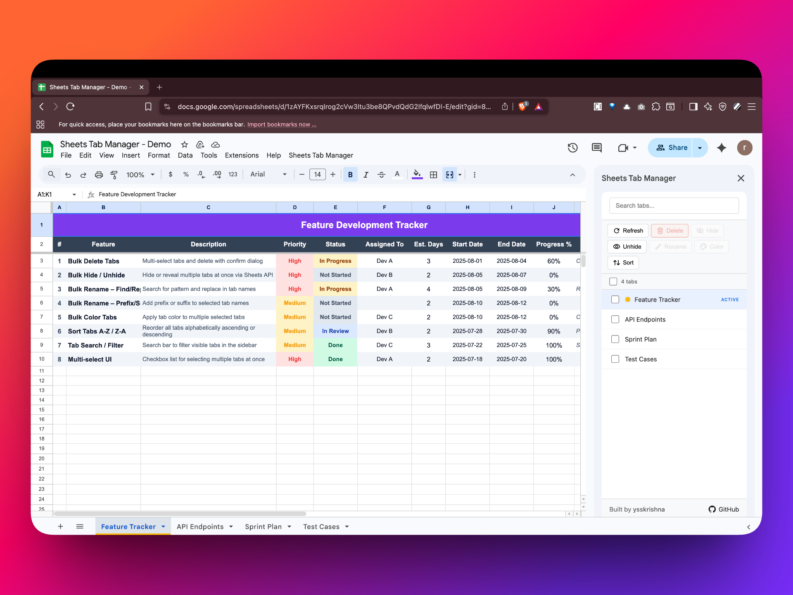
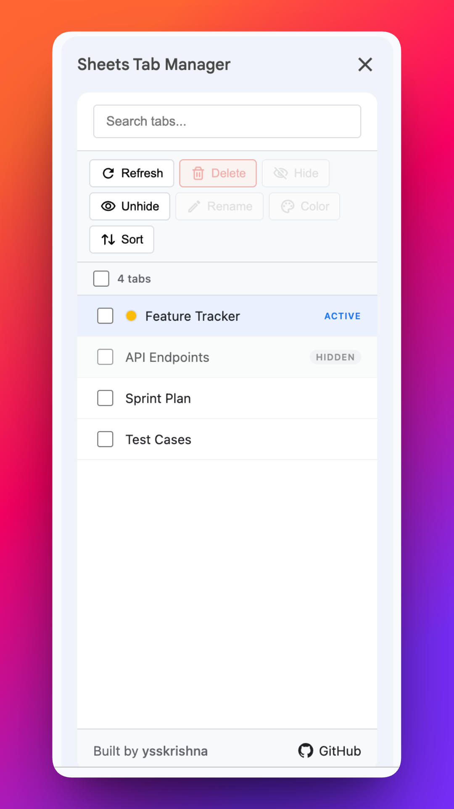
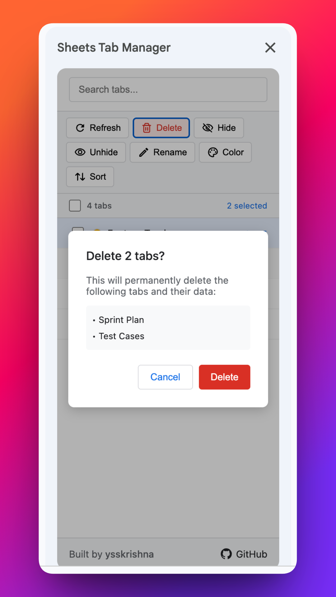
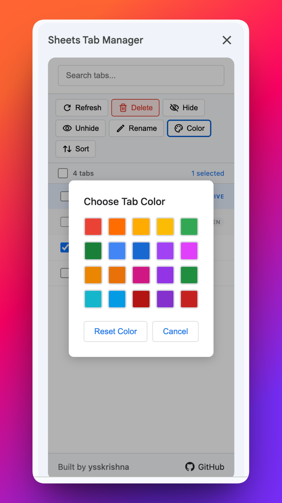
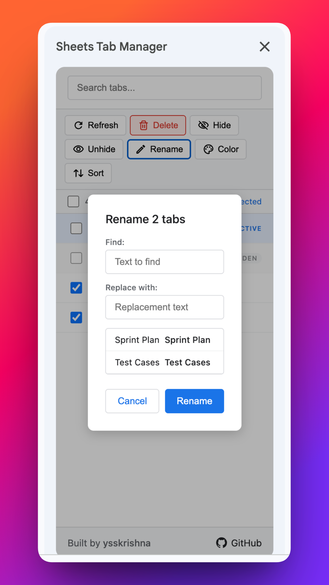
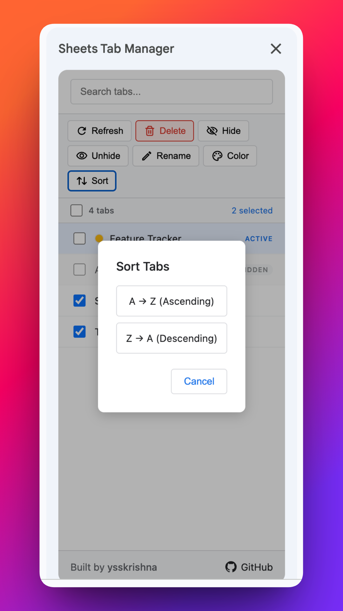

# Sheets Tab Manager

     

Google Sheets add-on for managing multiple tabs at once - delete, hide, rename, color, and sort with ease

## Features
- **Bulk delete tabs** - multi-select and delete with confirmation
- **Bulk hide tabs** - hide selected tabs from the tab bar
- **Bulk unhide tabs** - unhide the selected hidden tabs from the tab bar
- **Bulk rename tabs** - rename one tab, or find/replace across several selected tab names
- **Bulk color tabs** - apply tab color to multiple tabs
- **Sort tabs** - reorder tabs A-Z or Z-A
- **Tab search/filter** - search bar to find tabs

## Screenshots

## Built and maintained by

Sheets Tab Manager is built and maintained by:

| | Name | GitHub | Role |
|---|------|--------|------|
|  | **Y. Siva Sai Krishna** | [@ysskrishna](https://github.com/ysskrishna) | Creator |

## Changelog

See [CHANGELOG](CHANGELOG.md) for release history.

## Support

If you find this project helpful:

- ⭐ Star the repository
- 🐛 [Report issues](https://github.com/ysskrishna/google-sheets-tab-manager/issues)
- 🔀 Submit pull requests
- 💝 [Sponsor on GitHub](https://github.com/sponsors/ysskrishna)

---

  <a href="https://github.com/ysskrishna">Author's GitHub</a> •
  <a href="https://linkedin.com/in/ysskrishna">Author's LinkedIn</a> •
  <a href="https://ysskrishna.space">Author's site</a> •
  <a href="https://workspace.google.com/marketplace/app/sheets_tab_manager/430663965462">Add to Google Sheets</a> •
  <a href="https://ysskrishna.github.io/google-sheets-tab-manager/">Documentation</a> •
  <a href="https://www.ysskrishna.space/products/57-google-sheets-tab-manager">Product page</a> •
  <a href="https://www.ysskrishna.space/products?category=google-workspace-add-ons">More Google Workspace add-ons</a> •
  <a href="https://www.ysskrishna.space/blog/tag/google-sheets-tab-manager">Sheets Tab Manager blog</a> •
  <a href="https://github.com/ysskrishna/google-sheets-tab-manager/issues">Report Issues</a>

